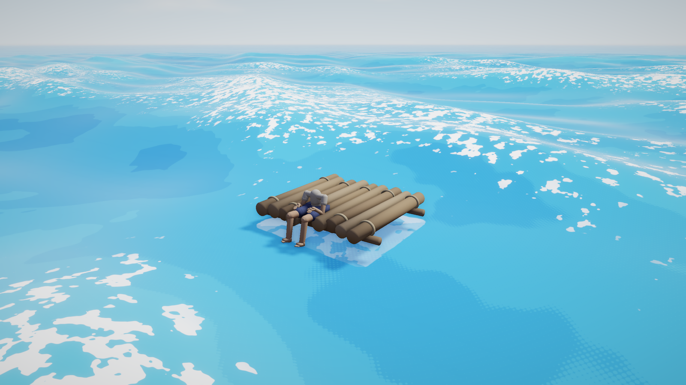

# Float

**SET + DRIFT**



You are adrift. The raft is small and honest — logs you lashed yourself — and
the ocean is enormous and indifferent. Nothing is asked of you. You can look at
your feet in the water, watch the light change, listen.

A contemplative first-person experience built on the [Flint](https://github.com/chrischaps/Flint)
engine, included here as a git subtree at `engine/`.

## Pillars

- **The ocean is the protagonist.** Wave motion has to be believable — real
  dispersion, real steepness — because your body reads the deck's hesitation
  before it follows a swell. Everything else can be a drawing. The physics
  cannot.
- **Stylized, not photoreal.** Flat bold blues, hard-edged graphic foam, pastel
  skies. Cel bands, not gradients. The water is a woodblock print that moves
  like the sea.
- **Time is the drama.** Sunrise, noon glare, red sunset, violet dusk,
  starscape — one continuous parameter, no cuts. A day takes about ten minutes
  and nothing else "happens."
- **Quiet interactivity.** Look around. Scoot along the edge. The absence of
  goals is the point.

## Running it

```
build.bat                 # cargo build --release in engine/
play.bat [scene]          # run scenes/float.scene.toml (default)
play_sfx_only.bat [scene] # same, music bus muted
render.bat [quick]        # headless PNG snapshots into snapshots/
```

Mouse or right stick to look. `A`/`D` or left stick to scoot around the raft's
edge. `F3` opens the debug panels. `Escape` releases the cursor.

Schemas layer engine-first, game-second:
`--schemas engine\schemas --schemas schemas`.

## Layout

| Path | |
|------|---|
| `engine/` | Flint as a git subtree (remote `engine`, branch `main`) |
| `scenes/` | `float.scene.toml` is the game; `snap_*.scene.toml` are headless render fixtures |
| `scripts/` | Rhai — buoyancy, camera, weather, wildlife, world events |
| `schemas/` | Game component schemas, layered over `engine/schemas` |
| `models/` `audio/` `sprites/` `textures/` | All generated — see `tools/` |
| `tools/` | Python generators (trimesh + pygltflib models, numpy audio, PIL textures) |
| `specs/` | Design notes |

Assets are **generated, not authored**. `models/body.glb` comes out of
`tools/generate_body.py`; the audio out of `tools/generate_audio.py`. Don't
hand-edit the outputs — change the generator.

## What happens out there

Nothing, mostly. That's the design. But the ocean is a system rather than a
backdrop, so the nothing has texture:

- **Weather** drifts on its own — a Markov walk across clear, scattered,
  overcast, rain and storm, with a physical lag cascade behind it. State moves
  the wind over ~20 s; wind builds the sea over ~2 min and lets it down over
  ~4, so a storm leaves a dying swell long after the clouds have gone.
- **A whale breaches** once at dusk, toward the sunset band, and you hear it a
  beat late because the sound had to cross the distance.
- **Seabirds** pass in loose Vs, densest near dawn, dealt fresh each time.
- **Dead calm** — rare, pre-dawn. Over eight unnatural seconds the sea
  collapses to glass and holds for four hours while the water mirrors the
  stars.
- **Another raft** drifts up out of the haze around noon of day 1, holds
  station ~18 m off, and leaves on a different bearing.
- **Reality tears** — the world's skin splits and another view bleeds through:
  waves as falling code, a blood sea at dusk, a drunken lean, a cyan
  wire-world. Under a minute. Never explained.
- **Underwater moments** — when a swell buries the eye, the frame goes
  genuinely under, and the soundscape drops behind a low-pass until you
  surface.

## Notes for anyone reading the code

- `flint-core/src/ocean.rs` is the single source of truth for wave math. The
  GPU only sums the array uploaded from there. That parity is what lets
  `ocean_height()` and the rendered surface be the same surface — which is what
  makes buoyancy work at all.
- **Script update order is a hash map.** "Declared after X" does not mean "runs
  after X". Nothing here reads another script's state and writes it back;
  systems publish factors and the one script that owns a field applies them.
- `flint render` runs **no scripts**, so headless captures of script-driven
  state need a baked `snap_*.scene.toml`. Skinned meshes render at bind pose.
- Schema defaults do **not** materialize component fields. Every field a script
  reads must be listed in the scene block, or the read returns unit.

`CLAUDE.md` is the long-form version of all of this.

## Engine changes

Engine work happens here, in `engine/`, tested against Float, then pushed
upstream:

```
git subtree push --prefix=engine engine feature/ocean-pipeline
git subtree pull --prefix=engine engine main --squash
```

Docs: [docs.chaps.dev/flint](https://docs.chaps.dev/flint)

## License

MIT — see [LICENSE](LICENSE).
